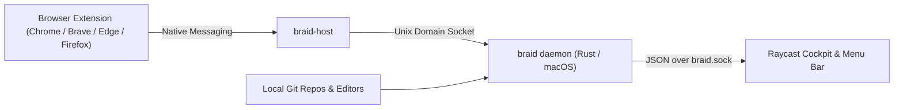

<div align="center">
  
  <p>
    <strong>A local macOS workspace cockpit for Raycast that links your Git repositories, code editors, and browser AI agents over a Unix domain socket.</strong><br/>
    ContextBraid pairs a native Rust daemon with a WXT browser extension and a Raycast interface so you can inspect live agent status, switch to the exact tab or editor window, and auto-download generated ZIP archives without cloud relays. Built for macOS developers running multiple repositories alongside Z.ai, Qwen, Gemini, Google AI, or DeepSeek sessions across Chrome, Brave, Edge, and Firefox.
  </p>
  <p>
    <a href="https://github.com/elcoosp/context-braid/actions/workflows/release.yml"></a>
    <a href="https://github.com/elcoosp/context-braid/releases"></a>
    <a href="#status"></a>
    <a href="#features"></a>
    <a href="PRIVACY.md"></a>
  </p>
  <p>
    <a href="#quickstart">Quickstart</a> •
    <a href="#features">Features</a> •
    <a href="#how-it-works">Architecture</a> •
    <a href="#usage">Commands</a> •
    <a href="PRIVACY.md">Privacy</a>
  </p>
</div>


## Quickstart

Requires **macOS** (Apple Silicon or Intel), **Raycast**, and **Chrome**, **Brave**, **Edge**, or **Firefox**.

### 1. Install the Raycast extension and native daemon

```bash
git clone https://github.com/elcoosp/context-braid.git
cd context-braid
pnpm install
pnpm --filter @context-braid/raycast dev
```

Open **Project Cockpit** in Raycast and press **Enter** on **Install and Start Engine** to download `braid-macos-universal`, install `ContextBraid.app`, and register the `launchd` background agent.

### 2. Load the browser extension

```bash
pnpm --filter @context-braid/extension build
pnpm --filter @context-braid/extension build:firefox
```

Load `packages/extension/.output/chrome-mv3` in `chrome://extensions` or `brave://extensions` (or `packages/extension/.output/firefox-mv2` in `about:debugging`), copy the 32-character Extension ID, and run **Connect Browser Extension ID** in Raycast.

### 3. Optional: Configure the Agent ZIP Drop Inbox (`⌘U`)

To let sandboxed browser AI agents push `.zip` deliverables straight to `~/Downloads` via a private GitHub Release:

1. Create a private GitHub repository (for example `<owner>/context-braid-drops`) with a draft or published release, and generate a fine-grained Personal Access Token with **Contents: Read and write** on that repository.
2. Save your configuration at `~/Library/Application Support/ContextBraid/drop.json`:

```json
{
  "repo": "<owner>/context-braid-drops",
  "release_id": 123456789,
  "token": "github_pat_..."
}
```

3. Select any repository in **Project Cockpit** and press **`⌘U`** (**Copy Agent ZIP Drop Prompt**) to copy a ready-to-paste `curl` upload snippet (excluding `.git`). When the agent finishes its turn, `braid daemon` automatically downloads the `.zip` into `~/Downloads`, deletes the temporary release asset, and sends a macOS notification.

## Features

- **Unified project cockpit**: Aggregates local Git status (`branch`, dirty file count, HEAD SHA, commit sparkline, and recent merged PR receipts) alongside open editor windows (`Cursor`, `VS Code`, `Zed`, `Neovim`) in a single Raycast list.
- **Multi-agent browser tracking**: Detects live session state (`working`, `completed`, `needs_attention`, `captcha`) across **Z.ai**, **Qwen**, **Gemini**, **Google AI**, and **DeepSeek** tabs in Chrome, Brave, Edge, and Firefox.
- **Background ZIP auto-download**: Monitors newly generated `.zip` artifacts via DOM observers and 6-second background alarms, saving them directly to `~/Downloads` even when tabs are hidden or windows are minimized.
- **Agent ZIP Drop Inbox (`⌘U`)**: Copies a pre-configured `curl` release-upload prompt for sandboxed AI agents and automatically pulls finished `.zip` deliverables into `~/Downloads` on turn completion.
- **macOS menu bar extra**: Separates active workspaces from idle repositories with native Raycast status icons, truncated tab titles, one-click tab focus, and 30-minute repo alert muting.
- **Zero-cloud local IPC**: All communication travels exclusively over `~/Library/Application Support/ContextBraid/braid.sock` via Chrome/Firefox Native Messaging (`braid-host`).
- **7-language localization**: Ships complete translations for English (`en`), French (`fr`), Simplified Chinese (`zh-CN`), Japanese (`ja`), German (`de`), Spanish (`es`), and Korean (`ko`).

## How it works

The browser extension observes supported AI agent tabs and forwards state updates through Native Messaging (`braid-host`) to the persistent Rust daemon (`braid daemon`), which merges them with local Git and window metadata for Raycast.



## Usage

| Command | Mode | Description |
| :--- | :--- | :--- |
| **Project Cockpit** (`index`) | View | Browse active workspaces and repositories, inspect commit history, focus AI tabs, or launch editors and terminals. |
| **Workspace Menu Bar** (`menu-bar`) | Menu Bar | Monitor active agent sessions and alerts from the macOS menu bar with one-click switching. |
| **Cycle Project Windows** (`cycle-project`) | No-view | Cycle focus across open project editor and browser windows. |
| **Jump to Next Agent Alert** (`jump-alert`) | No-view | Immediately focus the next browser tab waiting for input or review. |

Inside **Project Cockpit**, press **`⌘U`** to copy the **Agent ZIP Drop Prompt** for the selected repository, or **`⌘M`** to snooze repository alerts for 30 minutes.

> [!TIP]
> Inspect background ZIP auto-download diagnostics anytime from the ContextBraid Service Worker console by running `chrome.storage.local.get('cb_autodownload_logs', (d) => console.table(d.cb_autodownload_logs))`.

## Status

> [!NOTE]
> Active beta on macOS (`v0.1.8`). Tested with Node.js 24, Rust stable, Raycast API `1.104+`, Chrome/Brave MV3, and Firefox MV2 (`140.0+`).

For architectural invariants and local binary deployment steps, see [`AGENTS.md`](AGENTS.md) and [`PRIVACY.md`](PRIVACY.md).
