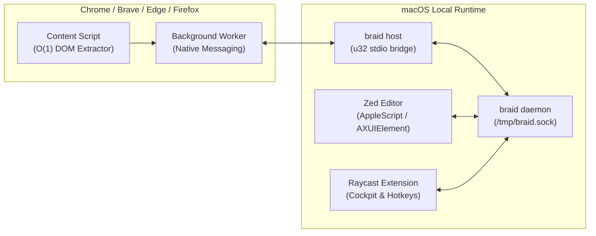

<div align="center">
  
  <p>
    <strong>A macOS workspace orchestrator that pairs local Git repositories, Zed editor windows, and AI browser tabs into unified project contexts.</strong><br/>
    ContextBraid runs a local Rust daemon over a Unix domain socket and bridges Chrome, Brave, Edge, Firefox, and Raycast via Native Messaging. Built for developers running parallel coding agents across z.ai, Qwen, Gemini, and Google AI Mode who want instant keyboard switching and immediate captcha or archive alerts without cloud telemetry.
  </p>
  <p>
    <a href="https://github.com"></a>
    <a href="https://github.com"></a>
    <a href="LICENSE"></a>
    <a href="#status"></a>
  </p>
  <p>
    <a href="#quickstart">Quickstart</a> •
    <a href="#features">Features</a> •
    <a href="#how-it-works">How it works</a> •
    <a href="#usage">Usage</a> •
    <a href="#status">Status</a>
  </p>
</div>

## Quickstart

Requires macOS 13+, [Raycast](https://raycast.com), and a supported browser (Chrome, Brave, Edge, or Firefox).

1. **Install the Raycast extension** from `packages/raycast` (`Import Extension` in Raycast).
2. **Load the browser extension** from `packages/extension/.output/chrome-mv3` (enable **Allow in Incognito** for private agent sessions) or `packages/extension/.output/firefox-mv2`.
3. **Bootstrap the local Rust engine** directly inside Raycast by opening **Open Project Cockpit** and pressing `Return` on **Install and Start Now** (or run from source below):

```bash
cargo build --release --workspace
./target/release/braid install
```

```text
ContextBraid installé et démarré depuis /Users/<you>/Library/Application Support/ContextBraid/bin/braid
```

## Features

- **Deterministic repository pairing**: Matches browser tabs to local repositories in `~/Documents/Repos` using `owner/repo` path extraction, whole-word specificity scoring, and `openerTabId` parent-tab inheritance (`crates/braid-core`).
- **Low-overhead DOM observation**: Extracts page titles, user prompt bubbles, and inline code blocks via targeted selectors debounced at 800 ms inside `requestIdleCallback` without reading `document.body.textContent` (`packages/extension/src/core/extractor.ts`).
- **Immediate agent state detection**: Surfaces Aliyun and Cloudflare captchas (`needs_attention`), active generation spinners (`working`), and completed `.zip` deliverables (`completed`) ahead of idle contexts.
- **Multi-browser and incognito isolation**: Indexes tabs by `(browser, window_id, tab_id)` with a 20-second TTL and 10-second keepalive so normal and private windows across Chrome, Brave, Edge, and Firefox never overwrite each other.
- **Zero-latency Raycast hotkeys**: Exposes two `no-view` Raycast commands (`cycle-project` and `jump-alert`) that talk directly to `/tmp/braid.sock` and unminimize or focus matching macOS windows via Accessibility APIs (`crates/braid/src/macos.rs`).
- **Single-binary self-installation**: Bundles the Unix socket daemon, Native Messaging stdio bridge, and `launchd` service installer into one `braid` executable (`crates/braid`).

## How it works

The browser extension observes supported AI domains (`*.z.ai`, `*.qwen.ai`, `://google.com`, `://google.com*`, `://deepseek.com`) and streams tab metadata over Chrome/Firefox Native Messaging to `braid host`, which forwards frames to `braid daemon` over `/tmp/braid.sock`. Raycast queries the same Unix socket to render grouped project workspaces and dispatch window-focus commands.



## Usage

### Raycast commands and recommended shortcuts

Assign global shortcuts in **Raycast Settings -> Extensions -> ContextBraid**:

| Command | Mode | Recommended Shortcut | Action |
| :--- | :--- | :--- | :--- |
| **Open Project Cockpit** | `view` | `Option + Space` | Lists braided repositories sorted by active alerts, with live status tags. |
| **Cycle Active Project Windows** | `no-view` | `Option + Tab` | Rotates focus across Zed and all AI tabs bound to the active repository. |
| **Jump to Next Agent Alert** | `no-view` | `Option + A` | Focuses the next tab blocked on a captcha or holding a completed `.zip` archive. |

### Configuration

`braid` reads `~/.config/contextbraid/config.toml` (created automatically with defaults if absent):

```toml
[repos]
root = "~/Documents/Repos"
ignore = ["node_modules", "target", ".git", ".output", ".wxt"]

[daemon]
socket_path = "/tmp/braid.sock"
```

### CLI subcommands

```bash
braid daemon                 # Run the Unix domain socket server (managed by launchd)
braid host                   # Run the Native Messaging u32-framed stdio bridge
braid install [EXT_ID]       # Install binary, Native Messaging manifests, and launchd agent
```

> [!TIP]
> If you load the browser extension unpacked during local development, copy its generated ID from `chrome://extensions` or `brave://extensions` and pass it via **Connecter un ID d'extension navigateur** inside Raycast or `braid install <EXT_ID>`.

## Monorepo layout

| Package | Path | Stack |
| :--- | :--- | :--- |
| `braid-core` | `crates/braid-core` | Rust 2024 — config parser, repository scanner, specificity matcher |
| `braid` | `crates/braid` | Rust 2024 + Tokio — Unix socket daemon, Native Messaging host, macOS window driver |
| `@context-braid/extension` | `packages/extension` | WXT 0.21 + Vite 8 + Vitest 5 Browser Mode (Chromium & Firefox) |
| `context-braid-raycast` | `packages/raycast` | Raycast API v2 + TypeScript |

## Status

> [!NOTE]
> **Beta (v0.1.0).** Tested on macOS Apple Silicon (`arm64`) with `cargo nextest` and Vitest Browser Mode against real Chromium and Firefox instances. Release builds package a universal `arm64` + `x86_64` binary via `.github/workflows/release.yml`.

- **Supported OS**: macOS (uses `osascript` and `AXUIElement` Accessibility permissions to raise and unminimize windows).
- **Supported browsers**: Google Chrome, Brave, Microsoft Edge, and Mozilla Firefox (`>= 140.0`).
- **Issues and feedback**: [GitHub Issues](https://github.com).
