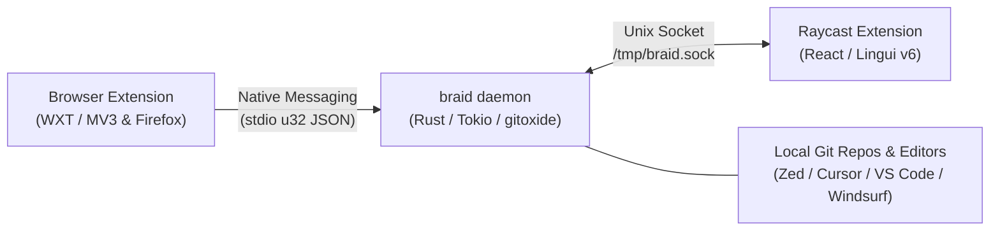

<div align="center">
  
  <p>
    <strong>A local macOS workspace cockpit linking Git repositories, code editors, and browser AI agents in one Raycast Split Pane.</strong><br/>
    ContextBraid indexes your repositories in sub-millisecond time with <code>gitoxide</code>, tracks live editor windows, pairs browser tabs via Native Messaging, and surfaces merged pull requests and 30-day commit velocity without spawning Git subprocesses.
  </p>
  <p>
    <a href="https://github.com/elcoosp/context-braid/actions"></a>
    <a href="https://github.com/elcoosp/context-braid/releases"></a>
    <a href="LICENSE"></a>
    
    
  </p>
  <p>
    <a href="#quickstart">Quickstart</a> •
    <a href="#features">Features</a> •
    <a href="#architecture">Architecture</a> •
    <a href="#usage">Usage</a>
  </p>
</div>

## Quickstart

Requires **macOS 13+** (Apple Silicon or Intel), **Rust** (2024 edition), **Node.js 22+**, **pnpm**, and [Raycast](https://www.raycast.com).

### 1. Build and install the background daemon

```bash
cargo build --release --workspace
./target/release/braid install
```

```text
ContextBraid installé et démarré depuis /Users/adm/Library/Application Support/ContextBraid/bin/braid
```

### 2. Build and load the browser extension

```bash
pnpm install
pnpm --filter @context-braid/extension build
```

1. Open `brave://extensions`, `chrome://extensions`, or `arc://extensions` and enable **Developer Mode**.
2. Click **Load unpacked** and select `packages/extension/.output/chrome-mv3`.
3. Copy the 32-character **Extension ID** and register it:

```bash
./target/release/braid install --extension-id <32-char-id>
```

### 3. Build the Raycast extension

```bash
pnpm --filter context-braid-raycast build
```

Open **Open Project Cockpit** in Raycast to inspect active workspaces, switch tabs or editor windows, and jump directly to agent alerts.

## Features

- **Sub-millisecond Git intelligence (`gitoxide`):** Reads `HEAD` branch, dirty working-tree file counts, latest commit summaries, and a 30-day commit velocity curve rendered as a transparent `2x` Retina PNG without spawning `git` subprocesses.
- **Recently merged pull requests:** Asynchronously queries merged PRs (Merge, Squash, and Rebase workflows) via `gh` cached per `HEAD` SHA and renders clickable GitHub links above the velocity chart.
- **Cross-surface project correlation:** Automatically links browser AI sessions (**Claude**, **ChatGPT**, **Gemini**, **Google AI**, **Qwen**, **z.ai**, **DeepSeek**, **Perplexity**, **Mistral**, **v0**, **Copilot**), live editor windows (**Zed**, **Cursor**, **VS Code**, **Windsurf**, **Neovim**), and local Git repositories.
- **Real-time agent status detection:** Surfaces live states (`Active`, `Working`, `Captcha`, `ZIP Ready`, `Ready`) across normal and incognito browser windows while preventing false archive alerts on search pages.
- **Native macOS window focusing and new-window launch:** Focuses exact browser tabs or editor windows via AppKit FFI (`NSRunningApplication`) and opens repositories in isolated new editor windows (`-n`) with `Cmd + E`.
- **Localized Raycast interface (Lingui v6):** Ships compiled English and French `.po` catalogs transformed at build time with `@lingui/core/macro` and `@lingui/swc-plugin`.

## Architecture



## Usage

### Configuration (`~/.config/context-braid/config.toml`)

```toml
repos_root = "~/Documents/Repos"

[editor]
favorite = "zed" # "zed" | "cursor" | "vscode" | "windsurf" | "neovim"
```

### CLI commands

| Command | Description |
| :--- | :--- |
| `braid daemon` | Run the background Unix socket broker and state indexer |
| `braid install [--extension-id <ID>]` | Install binary, register `launchd` agent, and write Native Messaging manifests |
| `braid native-host` | Native Messaging stdio bridge invoked by Chromium/Firefox browsers |
| `braid status` | Query live dashboard JSON from `/tmp/braid.sock` |

### Raycast shortcuts

| Shortcut | Action |
| :--- | :--- |
| `Enter` | Focus selected browser tab or editor window |
| `Cmd + E` | Open repository in a new favorite editor window (`-n`) |
| `Cmd + T` | Open repository in Terminal |
| `Option + Tab` | Cycle windows of the active project |
| `Option + A` | Jump to next agent alert (`Captcha` or `ZIP Ready`) |
| `Cmd + I` | Toggle Split Pane detail view |

## Status

> [!NOTE]
> Active development (`v0.1.0`). Tested on macOS (Apple Silicon and Intel) with Rust 2024 edition (`cargo nextest`) and Vitest Browser Mode across Chromium and Firefox.

## Learn more

- **Workspace packages:** [`crates/braid`](crates/braid), [`crates/braid-core`](crates/braid-core), [`packages/extension`](packages/extension), [`packages/raycast`](packages/raycast)
- **CI & Releases:** [`.github/workflows/release.yml`](.github/workflows/release.yml) — builds universal macOS binaries (`aarch64-apple-darwin` + `x86_64-apple-darwin`) on version tags (`v*`).
